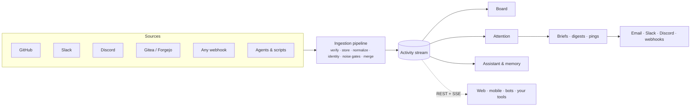

<div align="center">

# Worklog

**The shared picture of work for teams of humans and AI agents.**

See what everyone is working on · know what needs _you_ · ask anyone's assistant

</div>

---

Work is scattered across GitHub, Slack, Discord, calls and WhatsApp threads, and agents now do a growing share of it. Finding out what's going on usually means chasing people down.

Worklog pulls the **signal, not the noise,** into one place and keeps a living board. It tells you only what's actually blocked on you. And it gives everyone an assistant that knows their work, so teammates get answers even when you're away.

## A day with Worklog

|  |  |
| --- | --- |
| **08:30** | Your **morning brief** lands in Slack or email before stand-up: what you did yesterday, what the team moved forward, and what needs you. |
| **10:12** | Sam asks for your review on GitHub. You get **one ping, with a reason** ("Sam is waiting on your review to ship today"). The chatter in `#random` stays out. |
| **11:05** | A decision gets made on a call. You type `/log Agreed on FHIR R4 for referrals` and it lands on the right card. |
| **14:00** | You're offline. Ana **asks your assistant** where the retry logic lives. It answers from the work you've shared, and leaves you a note about the rest. |
| **15:40** | Your coding agent needs a decision, so you're pinged. When it finishes, the result **waits for your digest** instead of interrupting you. |
| **Fri 16:00** | A **weekly wrap**, written for you. |

## What's inside

- 🗂 **A board that stays honest.** Inspired by [Fizzy](https://fizzy.do): cards flow from _Maybe?_ through your columns to _Not now_ / _Done_. Golden tickets replace priority fields, and untouched cards drift away on their own. Before a card drifts, the assistant asks _"still on it?"_.
- 🌊 **An activity stream built for signal.** GitHub, Slack, Discord, self-hosted forges, manual and voice logs, and agents become one feed. Every delivery is stored, deduplicated, matched to the right person, filtered for noise and merged into readable items, and you can see why anything was skipped.
- 🔔 **Attention that respects your time.** Pings only for what's blocked on you, inside a daily budget, each with a "why now". Everything else arrives in the morning brief or one of two daily digests, delivered where you choose: email, Slack, Discord or a webhook.
- 🤖 **An assistant that knows your work.** Talk to it about your day. Teammates can ask it about your work when you're away (read-only, team-visible data). It learns how you work, and keeps private things private.
- 🧑‍🤝‍🧑 **Agents as teammates.** Cursor, Grok Bot, Claude Code or your own agents report their work, own cards, and only interrupt their human when they need a decision.
- 🔌 **Open by design.** One OpenAPI contract and one resumable event stream serve any client. Add a tool with a few lines of mapping rules (no code), a push script, or a typed connector.

## How it works



## Quick start

You need [Bun](https://bun.sh). There's no database to install: development uses embedded Postgres ([PGlite](https://pglite.dev)).

```bash
bun install
cd apps/api
cp .env.example .env     # everything is optional for local dev
bun run dev              # → http://localhost:4000/docs
```

Then create your workspace. People normally sign in (email link, GitHub, Discord or Slack) and call `POST /v1/workspaces`. For a quick local try there's a headless shortcut:

```bash
curl -X POST localhost:4000/v1/setup -H 'content-type: application/json' \
  -d '{"workspaceName":"My team","name":"Ada","email":"ada@example.com","timezone":"Africa/Kigali"}'
# → returns an API key: export WL="authorization: Bearer wl_…"

curl -X POST localhost:4000/v1/logs -H "$WL" -H 'content-type: application/json' \
  -d '{"text":"Call with the data team: agreed on FHIR R4 for referrals","kind":"decision"}'

curl -X POST localhost:4000/v1/briefs -H "$WL" -H 'content-type: application/json' -d '{"period":"daily"}'
```

**AI is optional.** Without a key, Worklog uses templates and rules. Add `OPENROUTER_API_KEY` and it uses Claude Opus 5.5 for conversations and briefs and Claude Haiku 5.5 for background work. Any [OpenRouter](https://openrouter.ai) model works.

## Connect your tools

| Tool | What Worklog picks up | How |
| --- | --- | --- |
| **GitHub** | PRs, reviews, issues, comments, pushes, releases. Review requests reach the reviewer; issues can become cards. | Webhook + secret |
| **Slack** | Work updates from the channels you choose, @mentions, edits and deletes; `/log`, `/worklog`, and `@worklog` in any thread. | Slack app |
| **Discord** | `/log`, `/now`, `/ask`, `/brief`, and delivery of briefs to a channel. | Interactions URL |
| **Gitea / Forgejo** | Same as GitHub, for self-hosted forges. | Webhook + secret |
| **Anything with webhooks** | Map payloads to events with rules: GitLab, Sentry, CI, deploy bots. | `webhook` connector, no code |
| **Your own code** | Push events from scripts and sync jobs. | `custom` connector + an `ingest` key |
| **Agents** | Progress reports with _working / needs you / finished / failed_. | `POST /v1/activities` |

`GET /v1/connectors` lists every connector and what it needs. See [docs/CONNECTORS.md](docs/CONNECTORS.md) for the pipeline, the noise rules, and how to add your own.

## Under the hood

- **Stack:** [Bun](https://bun.sh), [Hono](https://hono.dev) with `@hono/zod-openapi`, [Drizzle](https://orm.drizzle.team) on Postgres, [better-auth](https://better-auth.com), and the [Vercel AI SDK](https://ai-sdk.dev) with OpenRouter. Code style comes from [oxlint and oxfmt](https://oxc.rs) with [Ultracite](https://www.ultracite.ai)'s presets.
- **API:** 83 endpoints with stable operation ids (`card.close`, `conversation.chat`…). The spec is at `/openapi.json` and interactive docs at `/docs`.
- **Realtime:** Server-Sent Events with sequence ids, so a client that reconnects misses nothing. Chat streams in the AI SDK UI protocol, so `useChat` works on web and Expo.
- **Background work:** a Postgres job queue processes deliveries in order per connection, with retries. A scheduler runs briefs, digests, checks and nightly memory per person, on their local clock.
- **Privacy and safety:** team vs private visibility is enforced in queries, not prompts. Outbound messages keep only links that came from the source data. API keys are scoped (`read`, `write`, `ingest`).

## Project layout

```
apps/api/            the server
  src/
    api/             routes, auth middleware, webhook entry
    ingest/          the pipeline: types, identity, quality gates, effects
    connectors/      github · gitea · slack · discord · webhook · custom
    board/           cards, columns, entropy, drift nudges
    attention/       "needs you": quotas, feedback, actions, metrics
    automations/     briefs, digests, attention check, memory, custom routines
    agent/           the assistant: prompts, tools, models, streaming
    briefs/ memory/ delivery/ members/ auth/ jobs/ db/
  test/              74 tests, from pure normalizers to end-to-end flows
docs/                architecture, connectors, research notes
```

## Development

```bash
bun run test         # the full suite (~40 s; embedded Postgres, scripted AI model)
bun run typecheck
bun run lint         # oxlint with Ultracite's rules, type-aware
bun run format       # oxfmt
cd apps/api
bun run db:generate  # migrations after schema changes
bun run openapi      # print the OpenAPI spec (for client SDKs)
```

Git hooks (via [Lefthook](https://lefthook.dev)) lint and format staged files and check that commit messages follow [Conventional Commits](https://www.conventionalcommits.org). See [CONTRIBUTING.md](CONTRIBUTING.md) for conventions.

## Docs

- [Architecture](docs/ARCHITECTURE.md): how the server fits together.
- [Connectors & the activity stream](docs/CONNECTORS.md): the event model, the noise rules, identity, and adding tools.
- Research behind the design:
  - [proactive agents](docs/research/proactive-agents.md)
  - [activity ingestion](docs/research/activity-ingestion.md)
  - [AI SDK capabilities](docs/research/agent-sdk-capabilities.md)
  - [better-auth](docs/research/better-auth.md)
  - [Cursor & Grok Bot](docs/research/inspirations-cursor-grok-casa.md)

## Roadmap

- [x] API server: board, activity pipeline, attention, briefs, automations, assistant, memory
- [x] GitHub, Slack, Discord, Gitea/Forgejo, no-code webhooks, push API
- [x] Sign-in with email link, GitHub, Discord and Slack; scoped API keys for agents
- [ ] Web app: board, inbox and chat
- [ ] Mobile app (Expo) with push notifications
- [ ] MCP server, so coding agents can read the board and log work natively
- [ ] GitLab connector, Discord Gateway reader, backfill for missed webhooks
- [ ] Voice logs, transcribed on the server
- [ ] Generated TypeScript SDK (`packages/sdk`)

## Inspirations

[Fizzy](https://fizzy.do) by 37signals (the board) · [OpenCode](https://github.com/anomalyco/opencode) (one server, many clients) · [OpenClaw](https://github.com/openclaw/openclaw) (proactive agents) · [Cursor](https://cursor.com) and Grok Bot (agents as teammates).
